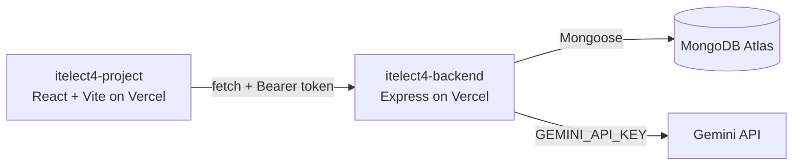

# itelect4-project

[](https://github.com/lyruslei/itelect4-project/actions/workflows/ci.yml)

**Campus Lost & Found Tracker**, the frontend: React 19 + TypeScript on Vite, with TanStack Query, React Hook Form + Zod and shadcn/ui. Students register, log in, report items they lost or found (private to their account), browse public claims, and use an AI Report Helper that checks whether an item description has enough detail.

- **Live site:** https://itelect4-project-delta.vercel.app
- **Live API:** https://itelect4-backend-mu.vercel.app/api/health
- **Backend repo:** https://github.com/lyruslei/itelect4-backend

## Architecture



## Run it locally

Needs Node 22.12 or newer (Node 24 recommended).

```bash
npm install
cp .env.example .env    # set VITE_API_URL, e.g. http://localhost:4000 (no /api, no trailing slash)
npm run dev             # http://localhost:5173
```

The backend has to be running too. See the backend repo's README.

## Tests

```bash
npm test                # Vitest, once
npm run test:watch      # Vitest, re-runs on save
```

Three test files, each beside the file it tests:

- `src/components/ClaimBadge.test.tsx`: a component render (status text, and the "No notes provided" fallback)
- `src/hooks/useToggle.test.ts`: a custom hook's state
- `src/pages/AiHelperPage.test.tsx`: form validation; a too-short description shows the schema's message and sends no request

GitHub Actions (`.github/workflows/ci.yml`) runs `npm ci`, `npm test` and `npm run build` on every push.

## AI-use disclosure

- **In the app:** the AI Report Helper page sends item descriptions to Google Gemini, through the backend's `POST /api/ai`. The browser never sees the Gemini key.
- **In development:** I used AI coding assistants while building this project: Google Antigravity for Sessions 1–10 (GT1–GT4), and Claude Code (Anthropic) for Sessions 11–12 (the Gemini AI route and page, the tests and the CI). I reviewed and tested the changes before merging them.
